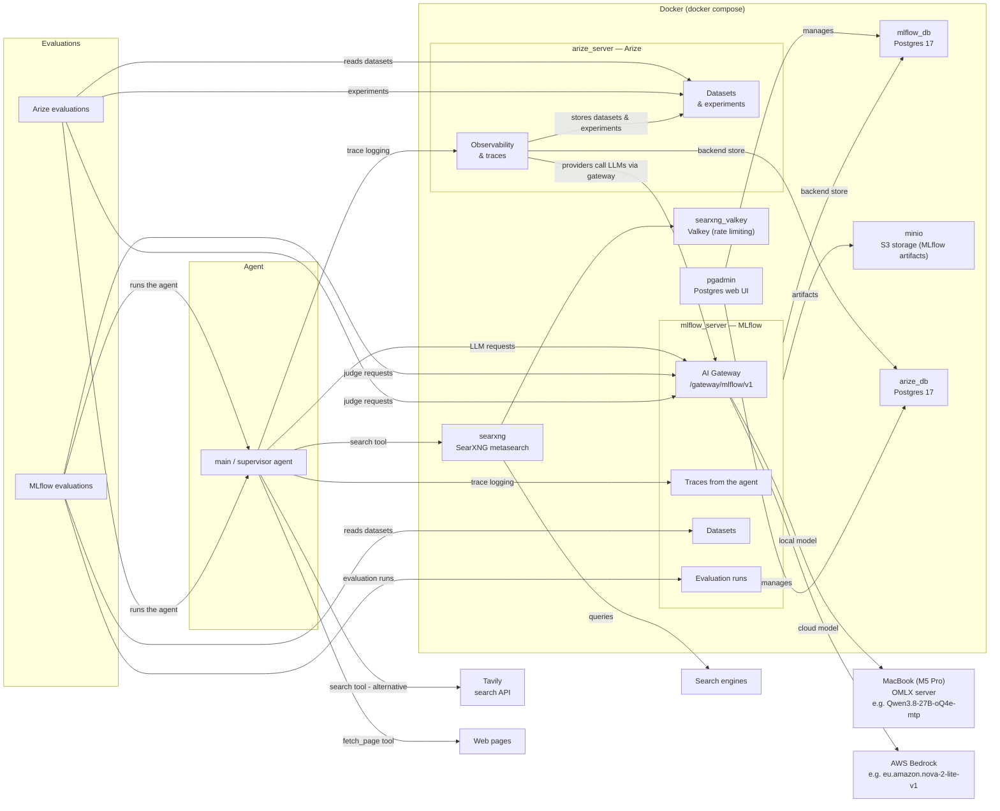
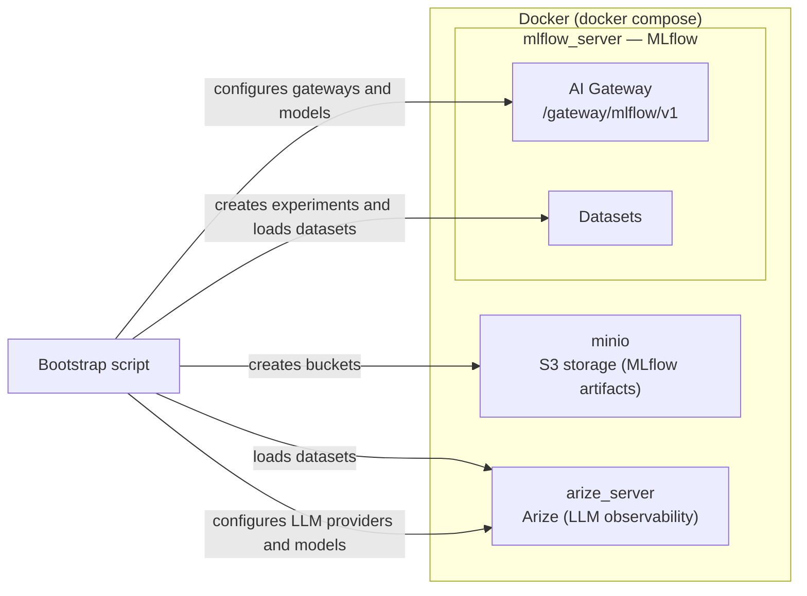
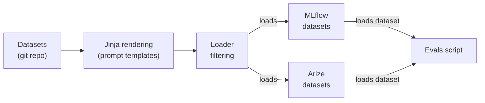
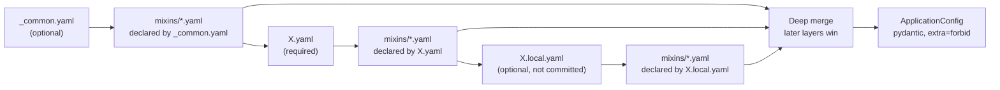
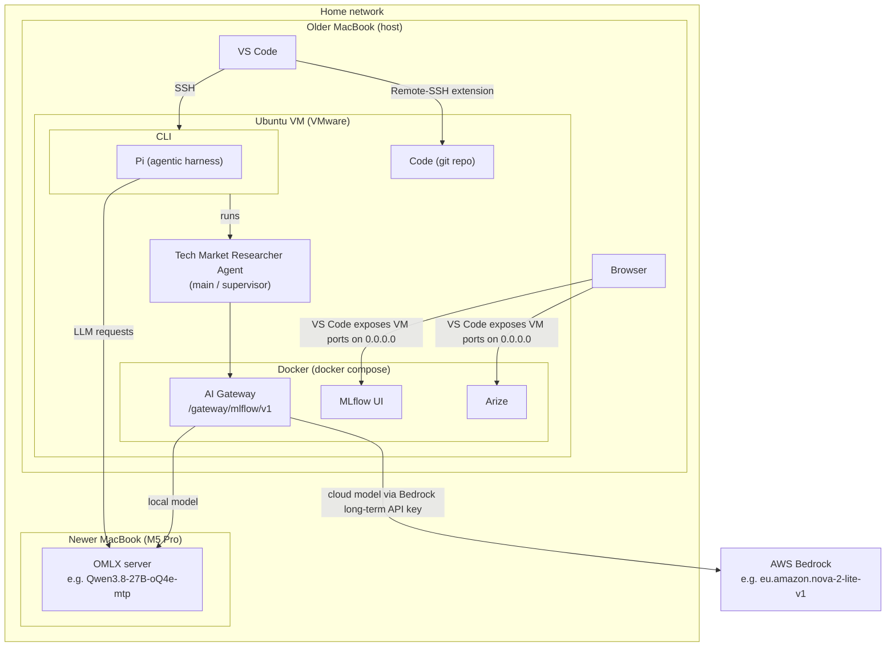

# Design

## Main Architecture

- **Agent** — an agent built on [LangChain](https://www.langchain.com) [deepagents](https://github.com/langchain-ai/deepagents) framework (currently just the main/supervisor agent). LLM requests go through the [MLflow](https://mlflow.org) AI Gateway; every run is traced back to MLflow.
- **Evaluations** — the evaluation code runs the agent over an evaluation dataset and scores each record with an LLM judge that also goes through the AI Gateway. Two platforms are supported: **MLflow** (datasets and results live in MLflow) and **Arize** (datasets and results are stored as a Phoenix experiment in Arize).
- **MLflow AI Gateway** — proxies OpenAI-compatible requests to either the local [OMLX](https://omlx.ai/) server on the MacBook (default) or [AWS Bedrock](https://aws.amazon.com/bedrock/), and records the agent's traces. It also monitors token usage and cost in real time, and supports budgets that cap spending, so a runaway agent run can't keep consuming tokens and money indefinitely.
- **Search** — the agent's search tool uses either the local [SearXNG](https://docs.searxng.org/) metasearch backend (which fans out to many public search engines) or the [Tavily](https://tavily.com) API, one or the other. It returns result titles, URLs and snippets only; a separate `fetch_page` tool fetches the content of individual pages (as markdown) when the agent needs it.
- **Supporting containers** — [Postgres](https://www.postgresql.org) (MLflow's backend store), [Arize](https://arize.com) (LLM/agent observability) with its own Postgres store, [MinIO](https://min.io) (artifact storage), and [pgAdmin](https://www.pgadmin.org) (database UI).

## Bootstrapping

The bootstrap script provisions the services below (node names match the Main Architecture diagram). It is intentionally not part of the main diagram.

The script runs in this order:

1. **MinIO** — creates the S3 buckets (the gateway's artifact root is `s3://mlflow-artifacts`, so the bucket must exist first).
2. **MLflow AI Gateway** — registers gateways and models.
3. **MLflow** — creates experiments and loads the (filtered) datasets.
4. **Arize** — loads datasets, then configures its custom LLM providers and models to point at the MLflow AI Gateway (so this must come after the gateway is set up).

## Evaluations

Evaluation flow, step by step:

- **Datasets** — stored in the git repo as the source of truth.
- **Jinja logic** — dataset records can use Jinja templating to render prompts before they are sent to the agent.
- **Loader** — a loader script applies filtering to the dataset and loads the records into MLflow (as a dataset) and Arize. It can load multiple datasets and merge them into a single MLflow or Arize dataset.
- **Evals script** — runs the agent over the evaluation dataset, loading it from MLflow or Arize depending on the selected platform.

### Scorer applicability (MLflow)

A built-in scorer is not always meaningful for every record (e.g. a correctness scorer with no expected answer, or a retrieval scorer for a run that never retrieved). For each scorer we therefore define an **applicability criterion** that is evaluated per record *after* the agent has produced its output, so it can inspect the record's inputs, the agent's response, and the trace. Most criteria are static checks (an expectation field present, a RETRIEVER span in the trace, or always applicable); for a few scorers an **LLM judge** decides applicability from the record's input and response, because the scorer's built-in semantics only hold for a subset of the records.

When a scorer is not applicable to a record, we return a hard-coded answer that is neither `yes` nor `no` (`not_applicable`). MLflow logs it per record but excludes non-`yes`/`no` values from the aggregated run metrics, so the recorded mean covers applicable records only instead of being diluted by records the scorer cannot judge.

Applicability criterion per scorer (MLflow built-in names):

| Scorer | Applicability criterion |
| --- | --- |
| `completeness` | Always applicable. |
| `correctness` | Applicable when the record carries an `expected_response` or `expected_facts` expectation. |
| `equivalence` | Applicable when the record carries an `expected_response` expectation. |
| `expectations_guidelines` | Applicable when the record carries `guidelines` expectations. |
| `fluency` | A judge decides whether the response contains prose text that can be assessed (a bare URL, e.g., does not). |
| `guidelines` | Always applicable. |
| `relevance_to_query` | Always applicable. |
| `retrieval_groundedness` | Applicable only when the trace contains at least one RETRIEVER span. |
| `retrieval_relevance` | Applicable only when the trace contains at least one RETRIEVER span. |
| `retrieval_sufficiency` | Applicable only when the trace contains at least one RETRIEVER span. |
| `safety` | Always applicable. |
| `summarization` | A judge decides whether the request asks the agent to summarize source content provided in the request. |
| `tool_call_correctness` | Always applicable. |
| `tool_call_efficiency` | Always applicable. |

### Evaluator applicability (Arize)

The same problem exists on the Arize platform: an evaluator is not always meaningful for every record. Phoenix differs from MLflow in that every logged evaluation counts toward the experiment mean and there is no `not_applicable` value to exclude from aggregation. The mechanism is therefore the inverse: a record the evaluator cannot judge must log **no evaluation at all**, so the mean covers applicable records only.

Each evaluator is therefore built with an **applicability criterion** (in `src/evaluations/arize/evaluators.py`), evaluated per record against the example fields the evaluators read; the criterion is met when the corresponding field is present and non-empty. Arize criteria are static field checks (the example fields are known ahead of the run); unlike MLflow, no judge decides applicability.

Field convention: expectations (`expected_response`, `expected_facts`, `expected_tool_calls`) live in the example's `output` field — the example's reference answer, which Phoenix passes to evaluators as `expected` — while supplementary annotations (`guidelines`, `tags`, `source_documents`, `available_tools`, `tool_calls`, `tool_results`) live in the example's free-form `metadata` field. The criteria below refer to those fields.

Applicability criterion per evaluator:

| Evaluator | Applicability criterion |
| --- | --- |
| `completeness` | Always applicable. |
| `conciseness` | Always applicable. |
| `correctness` | Applicable when the record carries an `expected_response` or `expected_facts` expectation. |
| `document_relevance` | Applicable only when the record carries `source_documents` metadata. |
| `expected_facts` | Applicable when the record carries an `expected_facts` expectation. |
| `exact_match` | Applicable when the record carries an `expected_response` expectation. |
| `faithfulness` | Applicable only when the record carries `source_documents` metadata. |
| `guidelines` | Applicable when the record carries `guidelines` metadata. |
| `hallucination` | Applicable only when the record carries `tool_results` metadata (without the tool results the judge cannot verify the response's claims). |
| `matches_regex` | Always applicable (code evaluator; disabled until a pattern is chosen). |
| `pii_detection` | Always applicable. |
| `precision_recall` | Applicable when the record carries an `expected_tool_calls` expectation. |
| `refusal` | Always applicable. |
| `retrieval_relevance` | Applicable only when the record carries `source_documents` metadata. |
| `tool_invocation` | Applicable only when the record carries `available_tools` metadata. |
| `tool_response_handling` | Applicable only when the record carries `tool_calls` metadata (the agent made tool calls). |
| `tool_selection` | Applicable only when the record carries `available_tools` metadata. |
| `toxicity` | Always applicable. |
| `user_friction` | Always applicable. |

Note: the current datasets do not yet populate `source_documents`, `available_tools`, `tool_calls` or `tool_results` metadata, so the retrieval, tool and hallucination evaluators are never applicable and log no metrics; their metrics appear as soon as the bootstrap attaches those fields to the examples.

## Configuration

Configs live in `config/` (agent configs under `config/agent/`) and are resolved by a generic `ConfigLoader` (`src/tech_market_researcher/core/config_loader.py`). For a config name `X`, the loader merges these layers, in this order (later layers win):

1. **Common config** — `_common.yaml` (optional): the shared baseline shared by all configs.
2. **Named config** — `X.yaml` (required): the per-environment config (e.g. `dev.yaml`, `prd.yaml`). A missing named file is an error.
3. **Local override** — `X.local.yaml` (optional): machine-local tweaks. Ignored by `validate_all_configs` and git-ignored (`config/**/*.local.yaml`), so it is never committed.

- **Deep merge** — dicts are merged recursively; scalars and arrays are replaced, never concatenated, so a later layer fully overrides a key.
- **Mixins** — any of the three layers may declare a `_mixins` list; each entry references `mixins/<name>.yaml`, which is merged on top of the layer that declares it (in declaration order). Mixins let shared fragments be reused across configs and local overrides; the `_mixins` field itself is dropped before validation. The `mixins/` folder is committed like the rest of the configs.
- **Validation** — the merged result is validated into a pydantic model (`ApplicationConfig` for the agent) with `extra="forbid"`, so a typo'd key in any YAML file fails at load time. `ConfigLoader.validate_all_configs()` loads every named config (without local overrides) so committed configs are checked by the unit tests and pre-commit.
- **Local overrides** — files named `X.local.yaml` are the mechanism for per-machine changes (e.g. pointing `dev` at a different local model) without touching committed files.
- **Loader configuration** — the loader is configurable via its constructor, e.g. base folder, common config filename, mixins folder, mixins field name, local-override infix, and file extension.

## Developer Setup

- **Newer MacBook (M5 Pro)** — dedicated to serving models through [OMLX](https://omlx.ai/), reachable over the local network. Its wired memory limit is raised as high as possible and no other applications run on it, so it is used for model serving only.
- **Older MacBook (host)** — runs VS Code on the host, which opens a remote CLI in the Ubuntu VM over SSH and edits the code in the VM directly using the Remote-SSH extension. A browser on the host is used to view the MLflow and Arize UIs; VS Code exposes the VM's service ports on 0.0.0.0 on the host. [VMware](https://www.vmware.com/) hosts the Ubuntu VM on this machine.
- **Ubuntu VM** — stores the code (the git repo) and runs all the scripts, the Docker services, and the [Pi](https://pi.dev) agentic harness. The Tech Market Researcher Agent is run from the CLI. It is deliberately a sandbox: it holds no secrets other than the ones this project needs and no personal user data.
- **Models** — Pi talks directly to the OMLX server; the DeepAgents agent goes through the MLflow AI Gateway, which routes to the OMLX server (default) or to [AWS Bedrock](https://aws.amazon.com/bedrock/). The gateway uses a long-term Bedrock API key to access Bedrock, which grants access to specific models only (Amazon Nova) and can be activated or deactivated at will.
