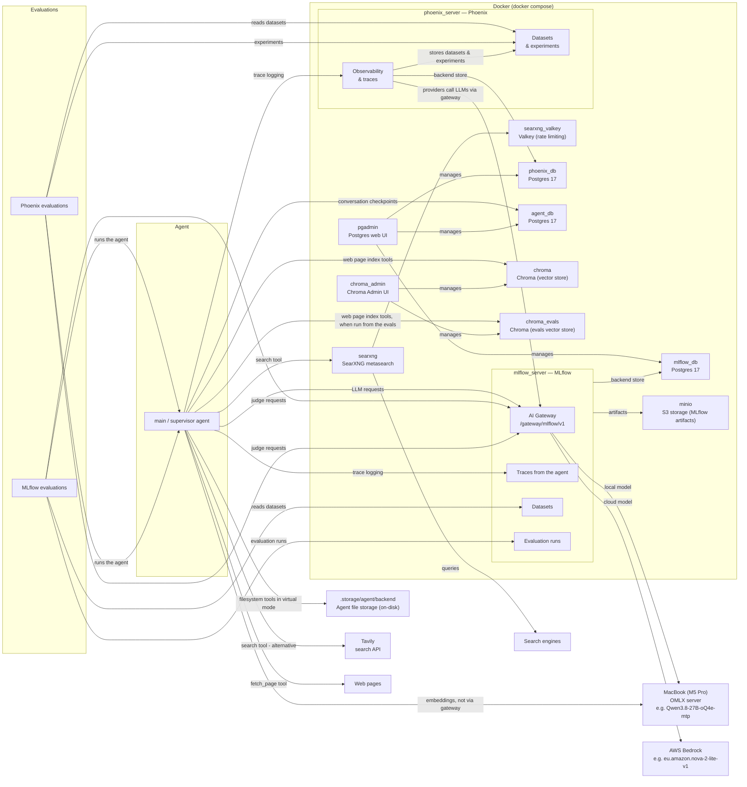
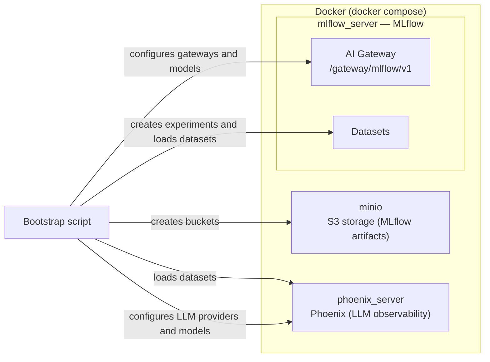
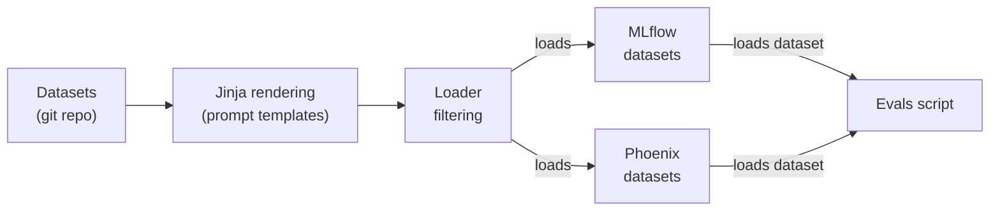
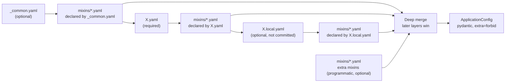
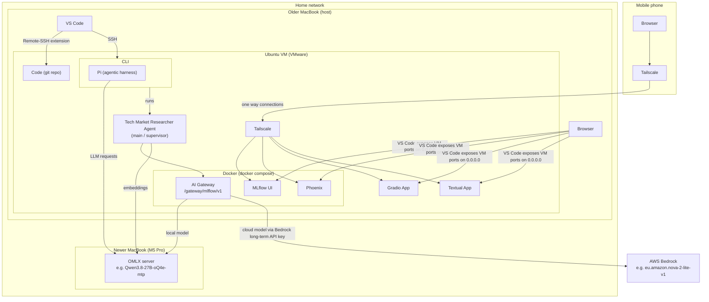

# Design

## Main Architecture

- **Agent** — an agent built on [LangChain](https://www.langchain.com) [deepagents](https://github.com/langchain-ai/deepagents) framework (currently just the main/supervisor agent), run interactively from the CLI or from a web UI (a [Gradio](https://gradio.app) app or a [Textual](https://github.com/Textualize/textual) app; see Developer Setup). LLM requests go through the [MLflow](https://mlflow.org) AI Gateway; every run is traced back to MLflow and Phoenix. The conversation state is checkpointed by the LangGraph checkpointer, selected in the agent config: in-memory (per process) or Postgres, stored in a dedicated schema of the agent database so the conversation persists across UI restarts. Filesystem tools are backed by a dedicated on-disk directory in virtual mode, so the agent's file operations are confined to its own storage area (with a cap on the size of individual files it can read).
- **Evaluations** — the evaluation code runs the agent over an evaluation dataset and scores each record with an LLM judge that also goes through the AI Gateway. Two platforms are supported: **MLflow** (datasets and results live in MLflow) and **Phoenix** (datasets and results are stored as a Phoenix experiment in Phoenix). When the agent is run from the evaluations, its web page index points at the dedicated `chroma_evals` Chroma instance instead of the main one, so evaluation runs do not pollute the agent's own index (see Evals vector store isolation).
- **MLflow AI Gateway** — proxies OpenAI-compatible requests to either the local [OMLX](https://omlx.ai/) server on the MacBook (default) or [AWS Bedrock](https://aws.amazon.com/bedrock/), and records the agent's traces. It also monitors token usage and cost in real time, and supports budgets that cap spending, so a runaway agent run can't keep consuming tokens and money indefinitely.
- **Search** — the agent's search tool uses either the local [SearXNG](https://docs.searxng.org/) metasearch backend (which fans out to many public search engines) or the [Tavily](https://tavily.com) API, one or the other. It returns result titles, URLs and snippets only; a separate `fetch_page` tool fetches the content of individual pages (as markdown) when the agent needs it.
- **Web page index** — the agent indexes web pages in the Chroma vector store and queries them with similarity search; documents are embedded by the OMLX embeddings endpoint, called directly by the agent (the AI Gateway does not proxy embeddings).
- **Supporting containers** — three separate [Postgres](https://www.postgresql.org) instances (MLflow's backend store, Phoenix's backend store, and the agent's database), two [Chroma](https://www.trychroma.com/) instances (the agent's vector store and a second one for the evals), [Chroma Admin](https://github.com/flanker/chromadb-admin) (their web UI), [Arize Phoenix](https://arize.com) (LLM/agent observability), [MinIO](https://min.io) (artifact storage), and [pgAdmin](https://www.pgadmin.org) (database UI for all three Postgres instances).

## Bootstrapping

The bootstrap script provisions the services below (node names match the Main Architecture diagram). It is intentionally not part of the main diagram.

The script runs in this order:

1. **MinIO** — creates the S3 buckets (the gateway's artifact root is `s3://mlflow-artifacts`, so the bucket must exist first).
2. **MLflow AI Gateway** — registers gateways and models.
3. **MLflow** — creates experiments and loads the (filtered) datasets.
4. **Phoenix** — loads datasets, then configures its custom LLM providers and models to point at the MLflow AI Gateway (so this must come after the gateway is set up).

## Evaluations

Evaluation flow, step by step:

- **Datasets** — stored in the git repo as the source of truth.
- **Jinja logic** — dataset records can use Jinja templating to render prompts before they are sent to the agent.
- **Loader** — a loader script applies filtering to the dataset and loads the records into MLflow (as a dataset) and Phoenix. It can load multiple datasets and merge them into a single MLflow or Phoenix dataset.
- **Evals script** — runs the agent over the evaluation dataset, loading it from MLflow or Phoenix depending on the selected platform.

### Scorer applicability (MLflow)

A built-in scorer is not always meaningful for every record (e.g. a correctness scorer with no expected answer, or a retrieval scorer for a run that never retrieved). For each scorer we therefore define an **applicability criterion** that is evaluated per record *after* the agent has produced its output, so it can inspect the record's inputs, the agent's response, and the trace. Most criteria are static checks (an expectation field present, a RETRIEVER span in the trace, or always applicable); for a few scorers an **LLM judge** decides applicability from the record's input and response, because the scorer's built-in semantics only hold for a subset of the records.

When a scorer is not applicable to a record, we return a hard-coded answer that is neither `yes` nor `no` (`not_applicable`). MLflow logs it per record but excludes non-`yes`/`no` values from the aggregated run metrics, so the recorded mean covers applicable records only instead of being diluted by records the scorer cannot judge.

Applicability criterion per scorer (MLflow built-in names):

| Scorer | Applicability criterion |
| --- | --- |
| `completeness` | Always applicable. |
| `correctness` | Applicable when the record carries an `expected_response` or `expected_facts` expectation. |
| `equivalence` | Applicable when the record carries an `expected_response` expectation. |
| `expectations_guidelines` | Applicable when the record carries `guidelines` expectations. |
| `fluency` | A judge decides whether the response contains prose text that can be assessed (a bare URL, e.g., does not). |
| `guidelines` | Always applicable. |
| `relevance_to_query` | Always applicable. |
| `retrieval_groundedness` | Applicable only when the trace contains at least one RETRIEVER span. |
| `retrieval_relevance` | Applicable only when the trace contains at least one RETRIEVER span. |
| `retrieval_sufficiency` | Applicable only when the trace contains at least one RETRIEVER span. |
| `safety` | Always applicable. |
| `source_document_groundedness` | Applicable when the record carries `source_documents` expectations. |
| `summarization` | A judge decides whether the request asks the agent to summarize source content provided in the request. |
| `tool_call_correctness` | Always applicable. |
| `tool_call_efficiency` | Always applicable. |

### Evaluator applicability (Phoenix)

The same problem exists on the Phoenix platform: an evaluator is not always meaningful for every record. Phoenix differs from MLflow in that every logged evaluation counts toward the experiment mean and there is no `not_applicable` value to exclude from aggregation. The mechanism is therefore the inverse: a record the evaluator cannot judge must log **no evaluation at all**, so the mean covers applicable records only.

Each evaluator is therefore built with an **applicability criterion** (in `src/evaluations/phoenix/evaluators.py`), evaluated per record against the example fields the evaluators read; the criterion is met when the corresponding field is present and non-empty. Phoenix criteria are static field checks (the example fields are known ahead of the run); unlike MLflow, no judge decides applicability.

Field convention: expectations (`expected_response`, `expected_facts`, `expected_tool_calls`) live in the example's `output` field — the example's reference answer, which Phoenix passes to evaluators as `expected` — while supplementary annotations (`guidelines`, `tags`, `source_documents`) live in the example's free-form `metadata` field. The criteria below refer to those fields.

Applicability criterion per evaluator:

| Evaluator | Applicability criterion |
| --- | --- |
| `completeness` | Always applicable. |
| `conciseness` | Always applicable. |
| `correctness` | Applicable when the record carries an `expected_response` or `expected_facts` expectation. |
| `expected_facts` | Applicable when the record carries an `expected_facts` expectation. |
| `exact_match` | Applicable when the record carries an `expected_response` expectation. |
| `faithfulness` | Applicable only when the record carries `source_documents` metadata. |
| `guidelines` | Applicable when the record carries `guidelines` metadata. |
| `hallucination` | Always applicable. |
| `matches_regex` | Always applicable (code evaluator; disabled until a pattern is chosen). |
| `pii_detection` | Always applicable. |
| `refusal` | Always applicable. |
| `toxicity` | Always applicable. |
| `user_friction` | Always applicable. |

### Evals vector store isolation

The evals and the agent must never write to the same vector store, for two independent reasons. First, the evaluations must not pollute the index the agent itself relies on in regular ("production") runs: evaluation runs index a lot of page content that would otherwise leak into the agent's normal retrieval. Second, the evaluations must not depend on — or be influenced by — data that pre-exists in the agent's index, so the evaluation results reflect only what the agent does during the evaluation run.

The first reason is handled by pointing the evals at a different database: when the agent is run from the evaluations, its web page index is pointed at the dedicated `chroma_evals` Chroma instance instead of the main `chroma` one.

The second reason is handled by isolating each conversation: every collection the index tools use is suffixed with the conversation's thread id (the user id plus the session id). Evaluation records run as separate conversations (each record gets its own session id by default), so each record reads from and writes to its own collections, and one conversation does not influence the results of another — an evaluation record cannot retrieve pages that a different record indexed.

As an extra measure, every collection the agent creates during an evaluation run is tagged with `created_during_evals: "true"`, and when the run finishes (even if it fails), the evals code deletes every collection in the Chroma database it used that carries that tag. This makes the deletion safe even if someone points the evals at the production Chroma database by mistake: only the collections created during the evals run are deleted, and everything else is left untouched.

## Configuration

Configs live in `config/` (agent configs under `config/agent/`) and are resolved by a generic `ConfigLoader` (`src/tech_market_researcher/core/config_loader.py`). For a config name `X`, the loader merges these layers, in this order (later layers win):

1. **Common config** — `_common.yaml` (optional): the shared baseline shared by all configs.
2. **Named config** — `X.yaml` (required): the per-environment config (e.g. `dev.yaml`, `prd.yaml`). A missing named file is an error.
3. **Local override** — `X.local.yaml` (optional): machine-local tweaks. Ignored by `validate_all_configs` and git-ignored (`config/**/*.local.yaml`), so it is never committed.
4. **Extra mixins** — optional mixins passed programmatically to `ConfigLoader.load` (e.g. via the `--extra-mixins` CLI flag of the agent and bootstrap commands, and `--extra-mixins-evals` / `--extra-mixins-agent` of the evaluations command); each entry references `mixins/<name>.yaml` and is applied on top of all the layers above, in the order given. A missing extra mixin file is an error.

- **Deep merge** — dicts are merged recursively; scalars and arrays are replaced, never concatenated, so a later layer fully overrides a key.
- **Mixins** — any of the three file layers may declare a `_mixins` list; each entry references `mixins/<name>.yaml`, which is merged on top of the layer that declares it (in declaration order). Mixins let shared fragments be reused across configs and local overrides; the `_mixins` field itself is dropped before validation and is not recursed into. The `mixins/` folder is committed like the rest of the configs.
- **Validation** — the merged result is validated into a pydantic model (`ApplicationConfig` for the agent) with `extra="forbid"`, so a typo'd key in any YAML file fails at load time. `ConfigLoader.validate_all_configs()` loads every named config (without local overrides) so committed configs are checked by the unit tests and pre-commit.
- **Local overrides** — files named `X.local.yaml` are the mechanism for per-machine changes (e.g. pointing `dev` at a different local model) without touching committed files.
- **Loader configuration** — the loader is configurable via its constructor, e.g. base folder, common config filename, mixins folder, mixins field name, local-override infix, and file extension.

### Extra mixins from the command line

Every entry point can apply extra mixins to the config it loads, without editing the config files. The flags are repeatable and applied in the order given (later ones win on conflicts); duplicate names are rejected, and a missing mixin file is an error.

| Command | Flag | Alias | Applies to | Mixins folder |
| --- | --- | --- | --- | --- |
| `agent_cli`, `agent_gradio_app`, `agent_textual_app` | `--extra-mixins` | `--x-mx` | the agent config | `config/agent/mixins/` |
| `bootstrap` | `--extra-mixins` | `--x-mx` | the bootstrap config | `config/bootstrapping/mixins/` |
| `evals` | `--extra-mixins-evals` | `--x-mx-ev` | the evaluations config | `config/evaluations/<platform>/mixins/` |
| `evals` | `--extra-mixins-agent` | `--x-mx-ag` | the agent config | `config/agent/mixins/` |

A mixin is a plain YAML fragment in the mixins folder of the config it applies to, containing only the keys it overrides; each flag repetition names one mixin file (without the `.yaml` extension), and the full flag name and its alias can be mixed freely.

## Developer Setup

- **Newer MacBook (M5 Pro)** — dedicated to serving models through [OMLX](https://omlx.ai/), reachable over the local network. Its wired memory limit is raised as high as possible and no other applications run on it, so it is used for model serving only.
- **Older MacBook (host)** — runs VS Code on the host, which opens a remote CLI in the Ubuntu VM over SSH and edits the code in the VM directly using the Remote-SSH extension. A browser on the host is used to view the MLflow and Phoenix UIs and the agent's web UIs; VS Code exposes the VM's service ports on 0.0.0.0 on the host. [VMware](https://www.vmware.com/) hosts the Ubuntu VM on this machine.
- **Ubuntu VM** — stores the code (the git repo) and runs all the scripts, the Docker services, and the [Pi](https://pi.dev) agentic harness. The Tech Market Researcher Agent is run from the CLI or from a web UI — the Gradio App (on port `8899`) or the Textual App (on port `8898`), both listening on `0.0.0.0`. It is deliberately a sandbox: it holds no secrets other than the ones this project needs and no personal user data.
- **Models** — Pi talks directly to the OMLX server; the DeepAgents agent goes through the MLflow AI Gateway, which routes to the OMLX server (default) or to [AWS Bedrock](https://aws.amazon.com/bedrock/). The agent also talks to the OMLX server directly for document embeddings (the web page index), since the gateway does not proxy the embeddings endpoint. The gateway uses a long-term Bedrock API key to access Bedrock, which grants access to specific models only (Amazon Nova chat models) and can be activated or deactivated at will. The full list of gateway models is in [models.md](models.md).
- **Mobile phone** — [Tailscale](https://tailscale.com/) is a software-defined mesh VPN, running on both the Ubuntu VM and the phone. It is configured with one-way access from the phone to the VM (the VM is sandboxed), so the browser on the phone can reach any UI running on the VM, for example: the MLflow UI, Phoenix and the agent's web UIs.
